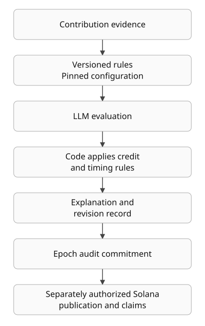

<picture>
  <source media="(prefers-color-scheme: dark)" srcset="apps/web/public/brand/hyphae-wordmark-dark.svg">
  
</picture>

# Hyphae

**Make community contributions inspectable: public rules, AI evaluation, readable explanations and verifiable settlement records.**

Token communities need a way to distinguish useful work from activity alone. Hyphae captures contributions, evaluates them against versioned rules, and keeps the reasoning and decision history available for inspection. When an epoch is published, a Solana program commits its payout root and audit hash; members claim with their own wallets.

[Try local fixtures](#try-local-fixtures) · [Engineering and evidence](docs/portfolio/ENGINEERING.md) · [Integration guide](docs/community/INTEGRATING.md)

Built solo for Colosseum's Crypto World's Fair in 2026, under the Organic/MYCEL umbrella. This public repository is **source-available under BUSL 1.1**.

## See the read path in three steps

The existing [SDK adopter app](examples/read-sdk-demo/README.md) uses synthetic data and displays **LOCAL FIXTURES** throughout. It demonstrates reading and failure handling, not AI scoring or a payment.

1. **Read Fern.** An open epoch has two contributions: one counted, one pending, and 75 points. Points are not payments.
2. **Switch to Moss.** A separate, closed community has genuine zero counts and no payable members.
3. **Simulate 503, then recover.** Values become **Unavailable**, not zero. Select Healthy read and use Read again to restore the selected community's data.

## Try local fixtures

Requires Node 22 and pnpm 10, as used by repository CI. From the repository root:

```sh
pnpm install --frozen-lockfile
node examples/read-sdk-demo/run.mjs
```

Open `http://127.0.0.1:8788`; stop with Ctrl-C. The runner packs the SDK, installs it into a disposable consumer with dependency scripts disabled, bundles the app and serves it on loopback. Installation may contact the package registry; community data comes only from local fixtures.

No API key, database, wallet or real identity is needed. There is no live mode, scoring call, registration, signing or payment. A local Windows browser check passed with Node 24.8.0 and pnpm 10.29.3 after selecting the installed pnpm entrypoint through the process-local `npm_execpath` variable. The direct command above hit a Corepack resolution failure on that machine; see the [validation receipt](docs/portfolio/VALIDATION.md) before assuming it works unchanged on Windows. No production service was involved.

## How it works

This is an explanatory pipeline from source, **not a recording of the fixture app**:



- **Explicit rules.** Public rubrics define criteria and flags. Epoch configuration pins scoring inputs; amendments and decision revisions have their own records.
- **AI with a bounded role.** Scorers return structured judgements and explanations. Code applies hard-zero flags, caps, the credit floor and timing rules. An explanation is evidence of a decision, not proof that the judgement is correct.
- **Separate evidence stages.** Points, allocation and confirmed payment are different states. Missing evidence stays unavailable. A root commits a payout list; it does not independently validate AI judgement.

Sources, architecture and evaluation limits are in [Engineering and evidence](docs/portfolio/ENGINEERING.md).

## Source, recording baseline and deployed evidence

Checked **2026-11-04**. Historical receipts do not establish current service health or deployment parity.

| Layer | What the evidence establishes |
|---|---|
| Source | This candidate was prepared against `main` at `fe53dee`. Source can advance without a corresponding API/worker deployment. |
| Recording baseline | [October 11 demo release](https://github.com/FCisco95/hyphae/releases/tag/hackathon-demo-2026-10-11), commit `09f5c4d`. A dated source baseline, not a current deployment assertion. |
| Historical mainnet result | [Epoch 3, October 19](docs/evidence/2026-10-19-mainnet-payout-epoch-3.md): 824,499,992 lamports allocated to 17 wallets, with 8 lamports dust. At publication, 0 of 17 had claimed. This does not establish that all 17 were paid. |
| Earlier completed claims | [Epoch 2, October 10](docs/evidence/2026-10-10-mainnet-payout.md): four claims totalling 1,238,881,509 lamports. |
| Current deployed state | Not re-verified for this candidate. No live backend was contacted. The local demo proves neither production behavior nor payout activation. |

See the [build log](docs/BUILDLOG.md), [curated reviews](docs/evidence/REVIEWS.md) and [program evidence](docs/evidence/PROGRAM.md) for dated scope. The fixture demo has no scoring screen; scoring footage remains pending.

## Integrate or participate

The [integration guide](docs/community/INTEGRATING.md) covers the public read API and locally packed TypeScript SDK. The SDK validates responses, preserves exact unit strings and exposes unavailable states. It is privately packed; do not assume an npm release.

Real community setup is [operator-assisted](docs/community/SETUP-INTEGRATION.md). Adding the bot alone does not register a group. The [member receipt guide](docs/community/MEMBER-RECEIPTS.md) explains results and issues. Rules-test and hold checklists stay private; published allocation and payment receipts are public.

## Limits and trust

LLM evaluation can be wrong. The [evaluation harness](docs/rubrics/eval/README.md), [calibration report](docs/rubrics/eval/reward-eval-2-calibration.md) and [injection checks](docs/rubrics/eval/reward-eval-2-injection.md) document bounded experiments, not universal fairness or prompt-injection immunity.

The publisher chooses the payout list. The program verifies proofs and prevents repeat claims, but remains upgradeable. Points do not guarantee eligibility, funding or payment. Read [Security](docs/SECURITY.md), [Wallets](docs/WALLETS.md) and the [whitepaper](docs/WHITEPAPER.md) before real interaction. The demo needs no funds.

## Develop

The workspace uses TypeScript, Next.js, Hono, grammY, pg-boss and Drizzle/Postgres, with an Anchor Solana program. Node 22 and pnpm 10 run JS checks; program builds use WSL/Linux, Anchor 1.0.1 and Solana CLI 3.1.

```sh
pnpm test
pnpm typecheck
pnpm lint
```

Additional checks require Postgres 17 in Docker, the program toolchain above, and Python's standard library:

```sh
pnpm --filter @hyphae/api test:pg
anchor build && cargo test -p hyphae --tests
python3 tests/h_contract_vectors.py
```

No product suite was re-run for this documentation-only candidate. [Engineering and evidence](docs/portfolio/ENGINEERING.md) distinguishes check configuration from dated results; [Testing](docs/TESTING.md) also documents the real pilot's participation boundaries.

## License

[Business Source License 1.1](LICENSE), with the Additional Use Grant in that file; Change Date **2028-10-12**, Change License **GPL v2.0 or later**. BUSL 1.1 is not an Open Source license. The program and public rubrics are also available in [hyphae-program](https://github.com/FCisco95/hyphae-program).
