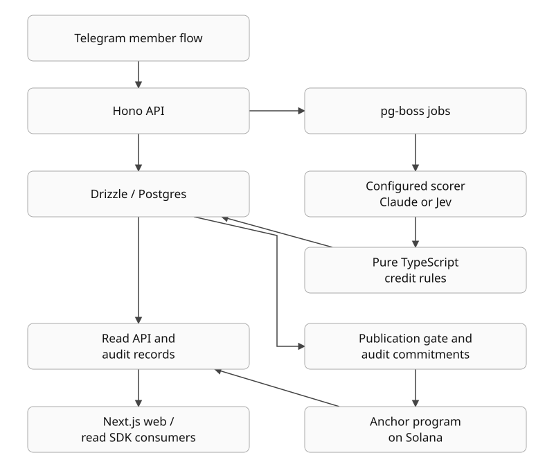

# Engineering and evidence

Inspected **2026-11-04** against source `fe53deec33245c5c1daa2cc9b7d23d422b4639ff`. Claims below describe source or dated evidence, not fresh production verification. [README](../../README.md).

## Architecture

This summarizes module responsibilities, not deployment state or currently selected providers.

| Responsibility | Source |
|---|---|
| Member entry and durable jobs | [Bot](../../apps/api/src/bot/index.ts), [jobs](../../apps/api/src/jobs/reward-jobs.ts), [schema](../../packages/db/src/schema.ts) |
| Capture, configuration, evaluation | [Intake](../../apps/api/src/rewards/intake.ts), [configuration](../../apps/api/src/rewards/config.ts), [evaluation](../../apps/api/src/rewards/evaluation.ts) |
| Deterministic rules | [Prompt/output contract](../../packages/core/src/reward-eval.ts), [credit arithmetic](../../packages/core/src/reward-points.ts), [commitment formats](../../packages/core/src/commitments.ts) |
| Publication and chain reads | [Commitment construction](../../apps/api/src/payout/commitments.ts), [gate](../../apps/api/src/payout/gate.ts), [settlement reader](../../apps/api/src/http/settlement.ts), [program](../../programs/hyphae/src/lib.rs) |
| Consumers | [Read service](../../apps/api/src/http/read-service.ts), [web](../../apps/web), [SDK](../../packages/read-client/README.md), [fixture app](../../examples/read-sdk-demo/README.md) |

## Claims and limits

| Presentation claim | Evidence | Limit |
|---|---|---|
| Explicit, versioned rules | [Public rubric](../rubrics/mycel-1.2.0.json), [history](../rubrics/CHANGELOG.md), configuration module above | Read the epoch configuration for its effective rules/scorer. MYCEL 1.3.0 is a candidate. |
| Structured LLM judgements with explanations | Reward contract and evaluation module above | Explanations can be mistaken. Provider support in source does not establish current selection or entitlement. |
| Code applies credit rules after model output | [Credit arithmetic](../../packages/core/src/reward-points.ts), [tests](../../packages/core/src/reward-points.test.ts) | Hard zeros, caps, floor and timing cannot eliminate model error in the inputs. |
| Decisions retain provenance and revisions | [Decisions](../../apps/api/src/rewards/decisions.ts), commitment construction above | Hashes bind recorded bytes; they do not prove external evidence or fairness of corrections. |
| Settlement is checkable against Solana | Program, settlement reader and [epoch-3 receipt](../evidence/2026-10-19-mainnet-payout-epoch-3.md) | A root proves a committed list. Allocation is not a completed claim. |
| Unknown values are not zero | [Demo consumer](../../examples/read-sdk-demo/app.js), [fixtures](../../examples/read-sdk-demo/fixtures.mjs), SDK above | Synthetic reads do not establish live API or payment status. |
| Separate communities in the fixture reader | Fixtures above and [browser verifier](../../examples/read-sdk-demo/verify.mjs) | Two synthetic communities are not a security audit of every multi-community flow. |

## Evaluation and checks

The [harness guide](../rubrics/eval/README.md) defines labelled cases, live/recorded modes and request/configuration fingerprints. Its eval-only `low_effort` zero differs from the production credit rule; compare equivalent policies before interpreting results.

[Calibration](../rubrics/eval/reward-eval-2-calibration.md), [injection checks](../rubrics/eval/reward-eval-2-injection.md) and [Jev calibration](../evals/jev-v4-calibration-2026-10-07.md) are dated experiments on bounded case sets. They are regression evidence, not general accuracy, safety or fairness guarantees. No paid inference or scoring evaluation was executed for this candidate.

[CI](../../.github/workflows/ci.yml) specifies tests, typecheck, lint, migration consistency, Postgres 17 suites and Python H-CONTRACT vectors. The [program workflow](../../.github/workflows/program.yml) separately covers program builds/tests. Configuration describes intended checks; dated results and reviewed ranges are in [curated reviews](../evidence/REVIEWS.md). Product suites were not re-run for this documentation candidate.

## Version evidence

| Reference | Meaning |
|---|---|
| Source `fe53dee` | Local `main` and fetched `origin/main` matched at intake. Root manifest is private with no product version; SDK version is 0.1.0. |
| `hackathon-demo-2026-10-11` → `09f5c4d0e2d40482ec70acad571e8a0963a9f82f` | [Recording baseline](https://github.com/FCisco95/hyphae/releases/tag/hackathon-demo-2026-10-11), published October 11, no downloadable assets. Not current runtime proof. |
| Historical mainnet evidence | [Epoch 2 claims](../evidence/2026-10-10-mainnet-payout.md) and [epoch 3 publication](../evidence/2026-10-19-mainnet-payout-epoch-3.md) prove different events. Do not merge totals or claim counts. |
| Deployed state now | Not checked. No live backend calls; parity and payout activation are not asserted. |

## Design and trust

The product is monochrome with Kumbh Sans; green means verified/paid. See [tokens](../../apps/web/app/globals.css), [font setup](../../apps/web/app/layout.tsx) and [brand assets](../../apps/web/public/brand). GitHub controls README typography; reusing the wordmark does not set GitHub's font.

Pure arithmetic is separate from I/O and model calls. The read SDK separates validation from scoring/signing. Verifiable transport and commitments still depend on captured evidence, model judgements and publisher decisions. The program is upgradeable. Private eligibility/checklists and public allocation/claim receipts have distinct disclosure boundaries: [security](../SECURITY.md), [member receipts](../community/MEMBER-RECEIPTS.md).
